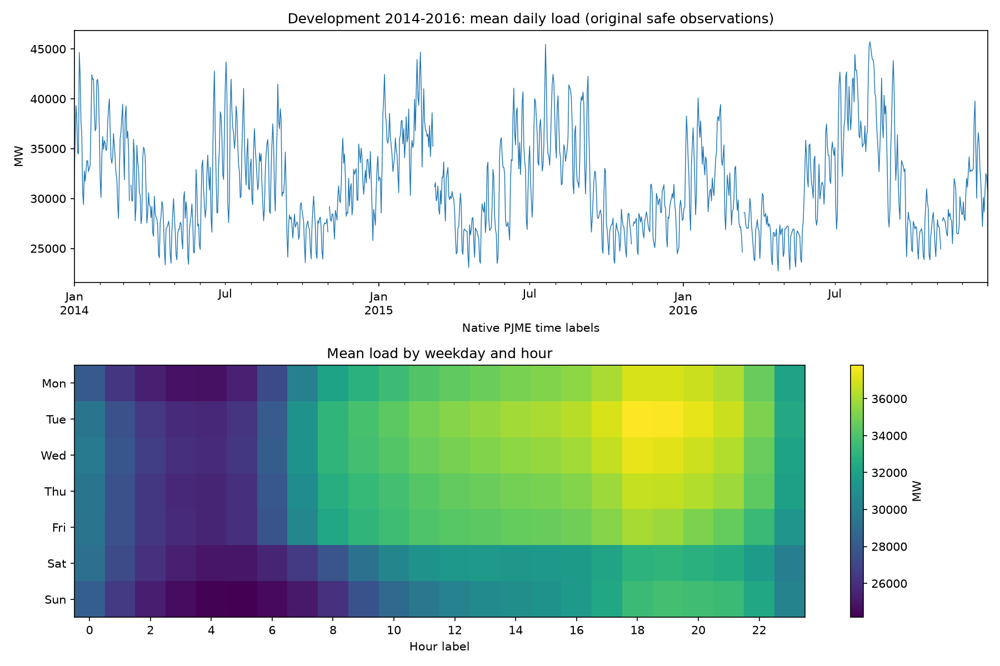

# Khảo sát dữ liệu phát triển 2014–2016

Chỉ dùng dữ liệu trước holdout 2017 để khảo sát mùa vụ. Không ghép thời tiết khi chưa xác nhận timestamp.

Số giờ lịch: 26,304; phụ tải quan sát còn lại: 26,160; thiếu/cách ly: 144.
Phụ tải quan sát: min 19,450, trung vị 30,483, max 56,391 MW.

## Tương quan với phụ tải quá khứ

| Độ lùi (giờ) | Tương quan Pearson |
|---:|---:|
| 1 | 0.9771 |
| 2 | 0.9154 |
| 24 | 0.8920 |
| 48 | 0.7732 |
| 168 | 0.7737 |
| 336 | 0.7527 |

Tương quan được tính trên cặp quan sát hợp lệ ở lưới giờ, không dồn hàng sau khi bỏ giờ thiếu. Đây là mô tả dữ liệu, không phải chỉ số dự báo ngoài mẫu.

Chi tiết từng tháng: development_monthly.csv. Các khoảng trống quanh DST được giữ nguyên, không dùng đường nối đồ thị để nội suy dữ liệu huấn luyện.
