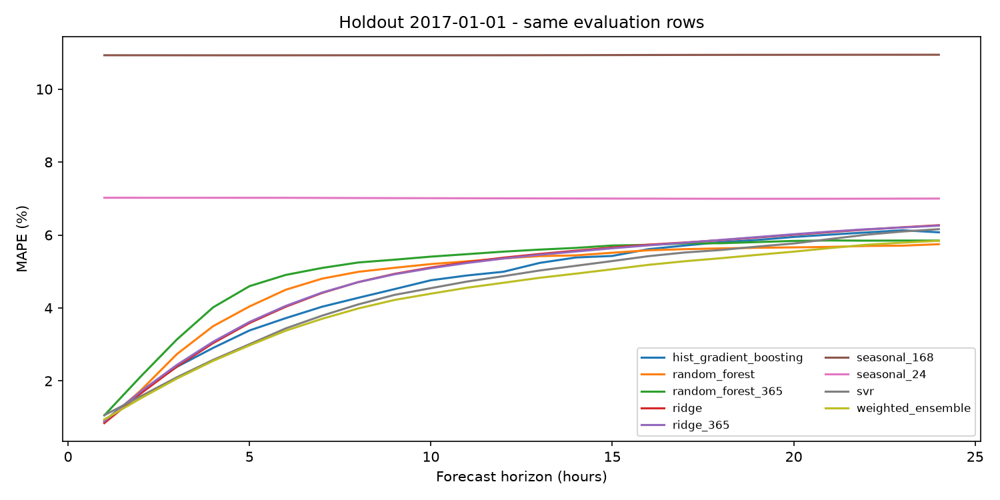

# Báo cáo thực nghiệm dự báo phụ tải

Nhánh: **none**. Cơ sở thời gian: **local_clock_unconfirmed_guarded**.

Huấn luyện/lựa chọn: 2014-01-01 đến trước 2017-01-01. Kiểm thử: 2017-01-01 đến trước 2018-01-01. Mỗi bước dự báo dùng mô hình riêng.

## Kết quả trên cùng tập thời điểm

| Mô hình | Chậm dữ liệu (giờ) | MAPE (%) | MAE (MW) | RMSE (MW) | MAPE tải cao (%) |
|---|---:|---:|---:|---:|---:|
| weighted_ensemble | 0 | 4.315 | 1336.6 | 1929.9 | 5.052 |
| svr | 0 | 4.486 | 1385.1 | 2010.6 | 5.038 |
| hist_gradient_boosting | 0 | 4.653 | 1441.0 | 2028.5 | 5.388 |
| random_forest | 0 | 4.808 | 1503.5 | 2148.4 | 5.839 |
| ridge | 0 | 4.834 | 1496.9 | 2078.0 | 5.990 |
| ridge_365 | 0 | 4.839 | 1499.1 | 2094.7 | 5.923 |
| random_forest_365 | 0 | 5.048 | 1579.3 | 2251.9 | 6.690 |
| seasonal_24 | 0 | 7.007 | 2174.0 | 2990.6 | 8.470 |
| seasonal_168 | 0 | 10.934 | 3449.3 | 4718.9 | 15.303 |
| weighted_ensemble | 1 | 4.529 | 1402.9 | 1998.3 | 5.312 |
| svr | 1 | 4.709 | 1454.4 | 2084.5 | 5.309 |
| hist_gradient_boosting | 1 | 4.866 | 1507.6 | 2089.8 | 5.671 |
| random_forest | 1 | 5.028 | 1571.7 | 2210.2 | 6.103 |
| ridge | 1 | 5.068 | 1569.1 | 2143.6 | 6.285 |
| ridge_365 | 1 | 5.070 | 1570.6 | 2160.8 | 6.211 |
| random_forest_365 | 1 | 5.263 | 1646.3 | 2313.8 | 6.972 |
| seasonal_24 | 1 | 7.148 | 2216.7 | 3055.8 | 8.641 |
| seasonal_168 | 1 | 10.934 | 3449.3 | 4718.9 | 15.303 |

Chậm 0 giờ: weighted_ensemble đạt MAPE 4.315%; đối chứng mùa vụ tốt nhất 7.007%. ML vượt đối chứng.

Chậm 1 giờ: weighted_ensemble đạt MAPE 4.529%; đối chứng mùa vụ tốt nhất 7.148%. ML vượt đối chứng.

## Tài nguyên và giới hạn

Tổng thời gian các khâu được đo riêng: 3015.0 giây; RAM RSS đỉnh lấy mẫu tại các khâu này: 713.5 MiB.
Đây là thống kê theo khâu; RAM đỉnh và thời gian hoạt động của toàn phiên được tổng hợp riêng trong resource_summary.json của báo cáo bàn giao.
Thời gian này gồm CV, tìm tham số, ablation và hai kịch bản độ trễ; chi phí thu thập được ghi riêng trong preparation_resources.json.
Các giờ DST không rõ nghĩa được cách ly. Xem coverage.json để biết tỷ lệ mẫu còn lại; không diễn giải kết quả như kiểm thử đầy đủ mọi giờ trong năm.
Kết quả gộp đánh giá từng lần phát hành dự báo: một giờ đích có thể xuất hiện ở nhiều khoảng cách dự báo.
Quy ước phụ tải vừa kết thúc đã có sẵn là giả định; dữ liệu đã sửa hồi tố chưa được khôi phục theo từng phiên bản.
Thời tiết Philadelphia chỉ đại diện một điểm; nhánh oracle (nếu chạy) giả định biết trước thời tiết, không phải độ chính xác vận hành.
Tập kiểm thử không được dùng để thay đổi cấu hình. Mục tiêu MAPE 3,5% không phải ngưỡng ép nghiệm thu.

Historical load revisions are not reconstructed.
Unknown convention: guarded local-clock windows, not a UTC operational replay.

## Lựa chọn trước khi xem kiểm thử

Mô hình mặc định theo validation: **weighted_ensemble**. Mô hình đơn dẫn đầu validation: **svr**, MAPE CV trên 24 bước **4.170%**. Thứ hạng trên bảng kiểm thử chỉ mô tả kết quả, không được dùng để thay đổi lựa chọn này.

MAPE kiểm thử của lựa chọn mặc định (độ trễ 0): **4.315%**. Chưa đạt mục tiêu nghiên cứu dưới 3,5%.

## Tài nguyên toàn phiên và kiểm tra bàn giao

Thời gian toàn phiên được quan sát: **59.9 phút**. RAM đỉnh toàn tiến trình: **1543.2 MiB**. Xem resource_summary.json để phân biệt thời gian toàn phiên với tổng thời gian từng khâu.

Phiên đầu bị ngắt trong lúc kiểm thử. Phần kiểm thử được khôi phục từ cấu hình/trọng số đã khóa; SHA-256 của các tệp lựa chọn được kiểm tra không thay đổi. Không tìm tham số lại. Thời gian trên cộng các khoảng hoạt động đã quan sát, không tính thời gian gián đoạn; đây không phải thời gian của một lượt chạy liền mạch.

Một lần dự báo đủ 24 giờ bằng mô hình mặc định có trung vị **1.68 giây** qua ba lần đo. Dữ liệu đầu vào đã ở trong bộ nhớ; phép đo gồm nạp mô hình và tạo đặc trưng, bộ đệm tệp có thể đã ấm. Xem inference_benchmark.json.

Bản chạy đầy đủ được khởi động trước tối ưu mặt nạ thời gian. Phép đo tối ưu riêng không được dùng để suy diễn hoặc hiệu chỉnh thời gian huấn luyện toàn phiên. numerical_replay_checks.json ghi đối chiếu số trên dữ liệu thật sau tối ưu.

Thời tiết đã được thu thập và kiểm tra, nhưng nhánh thời tiết chưa được huấn luyện khi quy ước timestamp còn chưa xác nhận. weather_status.json ghi trạng thái này. Các chỉ số trong bảng thuộc nhánh phụ tải và lịch.

Các tệp lớn (dự báo từng giờ và mô hình) nằm trong thư mục chạy gốc. Thư mục báo cáo này chỉ chứa kết quả nhỏ để nhóm chia sẻ và xem xét.

